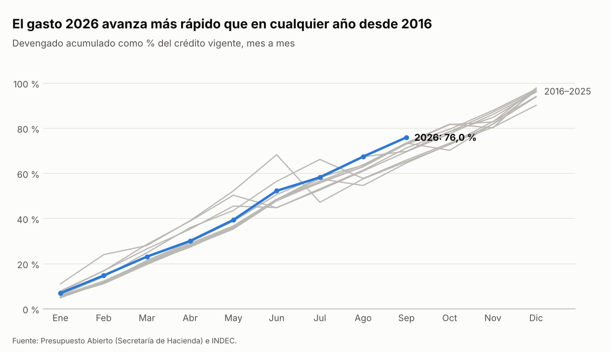
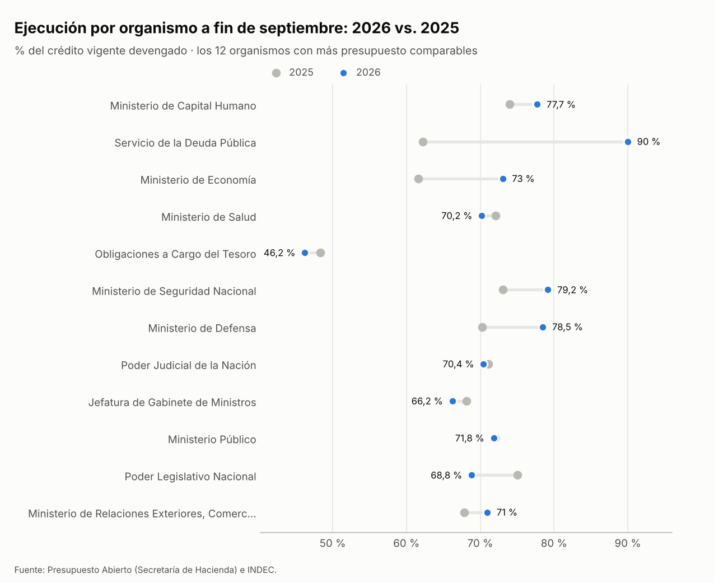
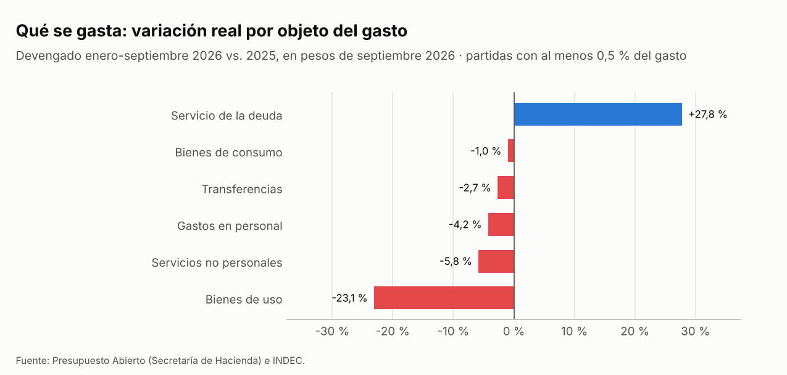
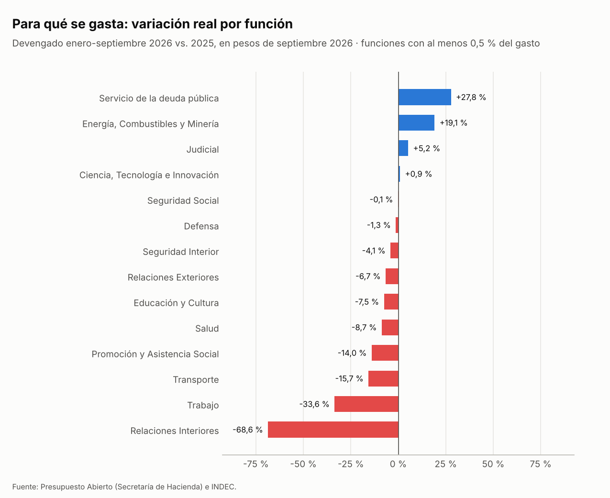
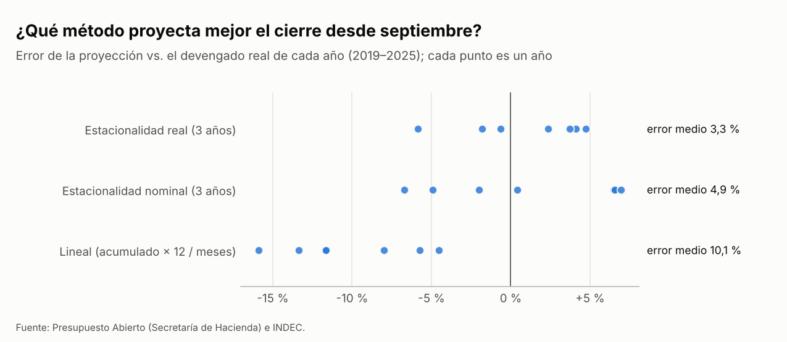

# Control presupuestario de la Administración Pública Nacional · enero-septiembre 2026

Datos de Presupuesto Abierto actualizados al 23/10/2026. Se analiza hasta el último mes completo (septiembre 2026). Importes en pesos corrientes salvo que se indique "real" (pesos de septiembre 2026, deflactados con el IPC del INDEC). 1 billón = 1.000.000 de millones.

## Resumen ejecutivo

- **Crédito vigente a fin de septiembre: $ 152,5 billones**, +3,0 % sobre el presupuesto aprobado ($ 148,1 billones).
- **Devengado enero-septiembre: $ 115,9 billones, el 76,0 % del vigente.** Es el ritmo más alto de la serie 2016-2025 (al mismo mes, los años anteriores estuvieron entre 64,6 % y 73,5 %).
- **En términos reales, el gasto enero-septiembre quedó -0,3 % contra 2025**, pero cambió la composición: intereses y deuda +27,8 %, personal -4,2 %, inversión física (bienes de uso) -23,1 %.
- **Deuda flotante (devengado y todavía no pagado): $ 3,2 billones**, 2,8 % de lo devengado (a septiembre 2025: 2,3 %).
- **Proyección de cierre: $ 161,2 billones** (rango $ 154,0 billones a $ 171,3 billones), el 105,7 % del vigente actual. Aun el extremo bajo del rango supera el crédito vigente: con este ritmo, el presupuesto actual no alcanza sin nuevas ampliaciones o una desaceleración del gasto. En los ejercicios cerrados, el vigente creció entre septiembre y diciembre una mediana de 10,5 %.

## 1. Conciliación y calidad de datos

Antes de analizar, la base se concilió contra dos publicaciones oficiales. Coincide al peso con la "Serie anual de gastos" en 9 de 10 ejercicios cerrados; no coincide en 2024. El archivo "Total Presupuesto y ejecución" difiere de la serie anual en varios ejercicios: las dos publicaciones oficiales no coinciden entre sí. Detalle en `resultados/tablas/conciliacion.csv`.

| Ejercicio | Presupuesto inicial | Devengado vs. serie anual | Devengado vs. totales | Vigente vs. totales |
|---|---|---|---|---|
| 2016 | coincide | 0 | 0 | 0 |
| 2017 | coincide | 0 | 0 | 0 |
| 2018 | coincide | 0 | +2,9 % | -2,4 % |
| 2019 | coincide | 0 | +4,8 % | +0,09 % |
| 2020 | coincide | 0 | +5,9 % | +0,3 % |
| 2021 | coincide | 0 | +1,0 % | < 0,01 % |
| 2022 | coincide | 0 | +1,6 % | 0 |
| 2023 | coincide | 0 | +2,3 % | 0 |
| 2024 | coincide | -0,2 % | +0,6 % | +0,03 % |
| 2025 | coincide | 0 | +0,5 % | +0,03 % |
| 2026 | coincide | - | 0 | 0 |

Problemas de calidad (meses inválidos, claves nulas, presupuesto inicial fuera de enero): 0.

## 2. Ritmo de ejecución

| Ejercicio | % del vigente devengado a fin de septiembre | Modificación del presupuesto al corte |
|---|---|---|
| 2016 | 69,8 % | +21,4 % |
| 2017 | 73,0 % | +1,5 % |
| 2018 | 73,5 % | +4,7 % |
| 2019 | 73,5 % | +2,9 % |
| 2020 | 65,9 % | +56,5 % |
| 2021 | 73,3 % | +13,7 % |
| 2022 | 71,3 % | +51,1 % |
| 2023 | 64,6 % | +28,2 % |
| 2024 | 65,2 % | +137,1 % |
| 2025 | 69,6 % | +32,7 % |
| 2026 | 76,0 % | +3,0 % |

## 3. Por organismo

Los organismos se reorganizan entre gestiones: se comparan por código y solo cuando el código existe los dos años. Tabla completa en `resultados/tablas/ejecucion_por_jurisdiccion.csv`.

## 4. Qué y para qué se gasta, en términos reales

## 5. Proyección de cierre

Se probaron tres métodos proyectando cada año cerrado desde septiembre, con datos disponibles a esa fecha. El de menor error, **estacional real**, se equivocó en promedio 3,3 % (máximo 5,9 %) en 7 ejercicios. El rango de la proyección aplica los errores mínimo y máximo de ese backtest: dice cuánto se equivocó antes, no es un intervalo de confianza formal.

| Método | Ejercicios | Error medio | Error máximo | Sesgo medio |
|---|---|---|---|---|
| estacional_real | 7 | 3,3 % | 5,9 % | +0,9 % |
| estacional_nominal | 7 | 4,9 % | 6,9 % | +1,0 % |
| lineal | 7 | 10,1 % | 15,9 % | -10,1 % |

## Limitaciones

- El devengado registra la obligación de pago, no el pago: la deuda flotante se mide como devengado menos pagado.
- El IPC del último mes puede revisarse; los montos reales cambian en consecuencia.
- La proyección supone que lo que resta del año sigue el patrón real promedio de los 3 ejercicios anteriores y que la inflación mensual de los últimos 3 meses se mantiene.
- Comparar organismos entre años está limitado por las reestructuraciones de ministerios.
